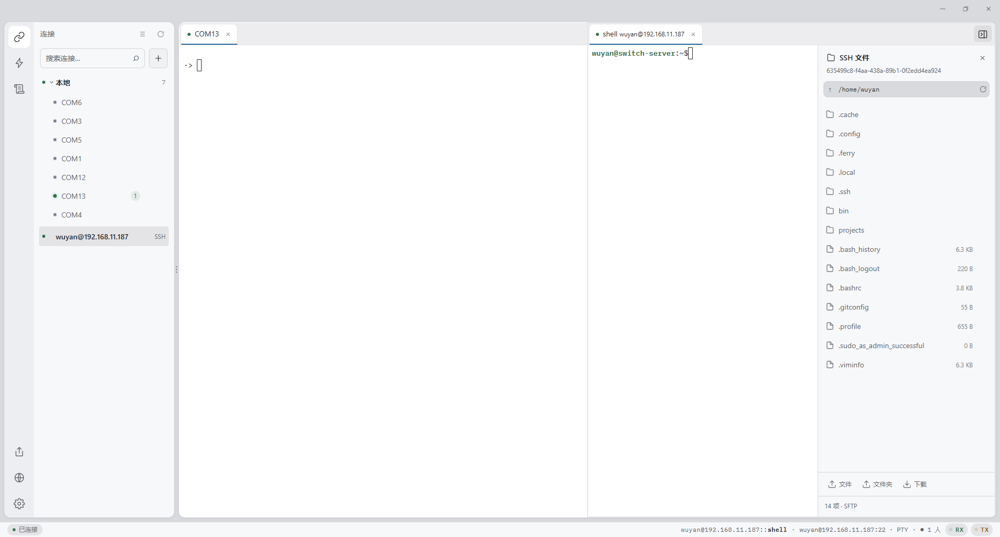

# Serial Studio

**English** · [简体中文](README.zh-CN.md)

<p></p>


**A device-debugging workbench — serial & SSH terminals, macros & scripting, MCP for AI agents.
Desktop, web, and remote devices. Built with Tauri + Rust + React.**

Serial Studio lets you talk to devices from a polished desktop app, from any
browser on your network, or driven by an LLM over MCP — over serial, over SSH into
remote Linux, or through boards cascaded in via the remote-device protocol — all backed
by the same Rust core. Multiple clients can share a single port, you can script
repetitive exchanges as macros, and label ports with device aliases.

<p align="center"></p>

---

## ✨ Features

- **Multi-port terminal** — concurrent ports in tabs or split side-by-side, powered by xterm.js.
- **Port sharing** — multiple windows / clients attach to the same port. The first opener's
  config wins; later clients join read/write. Force-close kicks every holder off.
- **Macros** — step sequences (`send` / `delay` / `expect` / `clear`), importable / exportable
  as JSON so they travel between machines.
- **Scripting** — full JS control flow (retry / branching / loops / parsing) for what macros can't express. Runs on the open port; pass a port arg to drive several ports from one script. Declare runtime parameters and they're collected in a popup, so reruns need no code edits.
Running scripts can be paused and resumed.
- **Port aliases** — label a port with the device it connects, e.g. `GPS (COM7)`.
- **SSH terminals** — log into remote Linux (servers, routers, OpenWrt) side by side with
  serial; a file panel prefers SFTP and falls back to an SSH compatibility mode for
  BusyBox/Dropbear — browse, preview, drag-drop upload, folder download. Host
  fingerprints verified.
- **Remote device cascade** — register remote devices (a full serial-studio or a
  few-dozen-KB bridge on the board); their ports appear locally as `nickname::port`,
  addressable from the Web UI, scripts and MCP alike, and can cascade multiple levels.
- **Three ways in:**
  - **Local** desktop app (IPC, bypasses the network entirely).
  - **Web** — open `http://host:port/` in a browser; the UI is embedded in the binary.
  - **Remote** — connect a desktop window to another machine's Serial Studio.
- **MCP** — expose ports to LLMs: 12 tools covering I/O, search, status and scripting,
  addressable by port name **or** alias; remote-device ports included.
- **Telnet** — works with classic terminal clients.

## 🧱 Architecture

Control plane and data plane are deliberately separated:

- **Control plane** (Tauri IPC) — settings, service lifecycle, alias & macro persistence.
- **Data plane** (axum) — WebSocket, MCP, Telnet, SSH, remote-device cascade; the
  serial side shares one `SerialManager` + `EventBus`.

### Crates

| Crate | Role |
|---|---|
| `ss-core` | Serial manager: port ownership (acquire / release / force-close), RX buffer, macro runner, QuickJS script engine (with pause/resume). Pure runtime — no persistence, no UI. |
| `ss-server` | axum WS / MCP / Telnet / SSH / remote-device cascade + embedded SPA (`rust-embed`). Shared by the Tauri shell and the standalone binary. |
| `serial-studio` (`tauri-app`) | The Tauri shell — service supervisor + control-plane commands. |

## 🛠 Tech stack

Tauri 2 · Rust (edition 2021, axum, serialport, tokio) · React 18 · TypeScript · Vite · xterm.js

## 📋 Requirements

- Rust (stable)
- Node.js (for the frontend)
- Windows: WebView2 (preinstalled on Win 10/11)
- A serial port (real or virtual)

## 🚀 Getting started

```bash
# build frontend + release binary
npm install --prefix ui
cargo tauri build

# or run in dev (hot-reload frontend)
cargo tauri dev
```

The release artifact is `serial-studio.exe`.

## 📖 Usage

- **Desktop** — run `serial-studio.exe`.
- **Web / in-browser** — the app runs a server (WS `18700`, Telnet `18701`). From any machine
  on the LAN, open `http://<host>:18700/`; the UI is served from the binary itself.
- **Remote window** — from the desktop app, open a remote window to another Serial Studio host.
- **Headless** — `serial-studio.exe --no-gui` runs only the backend (no window).

> **First run (unsigned build):** releases aren't code-signed yet.
> - **macOS** — Gatekeeper blocks it. After dragging to `/Applications`, strip the quarantine flag:
>   ```bash
>   xattr -dr com.apple.quarantine "/Applications/Serial Studio.app"
>   ```
> - **Windows** — SmartScreen warns; click *More info → Run anyway*.

> **Updates:** Windows and Linux builds self-update in-app (Help → About → Check for updates).
> **macOS does not auto-update** — without Apple notarization, a self-replaced `.app` gets
> re-blocked by Gatekeeper, so grab the new `.dmg` from the
> [Releases](https://github.com/wuyan19/serial-studio/releases) page manually.

## ⚙️ Configuration

Runtime config lives next to the binary:

| File | Holds |
|---|---|
| `settings.json` | server listen address / ports, `enable_scripting` and other switches |
| `ports.json` | per-port metadata (aliases) |
| `macros.json` | macros |
| `scripts.json` | script library |
| `remotes.json` | remote devices |
| `groups.json` | port groups |
| `ssh_hosts.json` / `ssh_known_hosts.json` | SSH hosts & fingerprints |

## 🤖 MCP

`POST /mcp` speaks JSON-RPC. Twelve tools: 6 basic (`serial_list`, `serial_send`,
`serial_read`, `serial_status`, `serial_grep`, `serial_clear`), 2 script execution
(`serial_debug_script` for ad-hoc JS, `serial_run_script` to run a saved script by name —
both gated by `enable_scripting`), and 4 script library management (`serial_save_script`,
`serial_get_script`, `serial_list_scripts`, `serial_delete_script` — data-only, not gated).
The `port` argument accepts a real port name **or** an alias.
Two prompts: `serial_usage_guide` (tool workflow) and `serial_script_guide`
(scripting API and constraints).

### Connect from Claude Code

```bash
claude mcp add --scope user --transport http SerialStudio http://<host>:18700/mcp
```

Replace `<host>` with the machine running Serial Studio (`127.0.0.1` for the local app).
Other MCP clients (Claude Desktop, etc.): add an HTTP MCP server pointing at the same URL.

### Raw JSON-RPC

```jsonc
{
  "jsonrpc": "2.0", "id": 1, "method": "tools/call",
  "params": { "name": "serial_send", "arguments": { "port": "GPS", "data": "AT", "timeout_ms": 1000 } }
}
```

## 🔌 Board integration (custom device side)

You don't need the full serial-studio on the board: implement the device-side subset of the
remote-device protocol with a tiny program, register the board's address in the hub UI, and its
UARTs show up as `nickname::port` everywhere — Web UI, scripts and MCP tools (agents reach the
board straight through MCP).

- Protocol contract: [docs/device-protocol.md](docs/device-protocol.md) (handshake / messages / binary data frames)
- Reference implementation: [examples/ss-board-bridge.c](examples/ss-board-bridge.c) — single-file C,
  libc only, `musl-gcc -O2 -static` produces a small static binary for any architecture.
- Prebuilt: static binaries for x86_64 / aarch64 / armv7 / riscv64 (plus a sha256 manifest)
  are attached to every Release — scp one to the board and run. For mips/mipsel, compile
  from source with a single musl-gcc command (see the protocol doc).

## 🔒 Security note

The server binds `0.0.0.0` by default and carries **no authentication**. Anyone who can reach
the port can open / send to your serial ports and read their output. Bind to `127.0.0.1` in
`settings.json`, or sit behind a firewall / VPN, for anything beyond a trusted LAN.

Remote JS scripting (WS `run_script` / MCP `serial_debug_script` + `serial_run_script`) is gated by `enable_scripting`
in `settings.json`, **off by default**. When enabled, any reachable client can execute JS
against your serial ports. The script sandbox exposes the serial primitives
(`send`/`expect`/`clear`/`sleep`) **and host-file read/write** (`read_file`/`write_file`/
`append_file` etc.) — there is no network or process access. Keep it disabled on untrusted
networks.

The script library tools (`serial_save_script` / `serial_get_script` / `serial_list_scripts` /
`serial_delete_script`) are data management and **always accessible** regardless of
`enable_scripting`: any reachable client can read saved script code (which may embed host
paths, LAN addresses, or credentials in comments), overwrite, or delete it. Same trusted-LAN
rule applies.

## 📁 Project layout

```
serial-studio/
├─ crates/
│  ├─ core/        # ss-core: serial manager + port ownership + macros + script engine
│  ├─ server/      # ss-server: axum WS/MCP/Telnet/SSH/device cascade + embedded SPA
│  └─ tauri-app/   # serial-studio: Tauri shell (control plane)
├─ ui/             # React + TS + Vite frontend
└─ Cargo.toml      # workspace
```

## 🤝 Contributing

Issues and pull requests welcome. This is a small project — keep changes scoped and match the
existing style.

## 📄 License

MIT — see [LICENSE](LICENSE).
