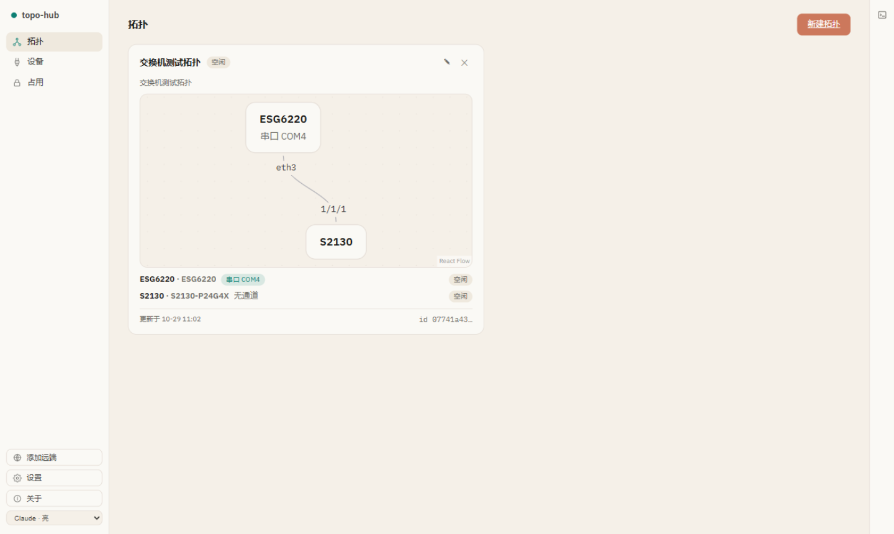

# devicerack

[English](README.md) · **简体中文**

面向 AI 真实设备调试阶段的**网络设备管理平台**：以设备为中心组织调试资源——设备注册、拓扑管理、占用租约、Agent 工具面；串口/SSH/远端级联等连接能力整体复用同一 Rust 底座。

与 Serial Studio 同底座、不同视角：Serial Studio 站在连接一侧（串口终端工具），devicerack 站在设备一侧（连接只是设备的访问通道）。

<p></p>

## ✨ 功能特性

- **设备注册表**——被测设备是一等实体（名称/型号/位置），串口控制台与 SSH 登录作为设备的接入通道内联管理；未注册端口仍可直接访问（现场兜底）。
- **拓扑管理**——多拓扑画布编辑（拖拽布局、设备间连线、物理端口标签如 `GE0/1`），成员引用设备、一台设备可属多个拓扑。
- **占用租约**——设备级排他写权（all-or-nothing）：冲突整体拒绝并告知持有者，TTL 到期自动释放，支持排队等待；Web 端占用中心供人查看与强制收回。租约即写权：拿到租约即可直接下发命令。
- **设备本体论 MCP 工具面（11 工具）**——发现（`get_topology` / `get_device` / `list_my_leases`）+ 租约（`acquire_lease` / `renew_lease` / `release_lease`）+ I/O（`exec_command` / `open_session` / `send_input` / `read_output` / `close_session`）。设备+通道寻址，Agent 不接触端口键；设备/拓扑管理等管理工具经声明从工具清单隐藏（调用不受影响）。
- **终端面板**——设备通道即点即开，会话跨页存活；认证失败有重输密码的修复闭环。
- **多实例级联与访问控制**——远端实例级联组网；远程访问验证（一次性验证码 + TLS）可按连接启用。

## 🧱 架构

| Crate | 职责 |
|---|---|
| `ss-core` | 串口引擎：端口生命周期、事件总线、脚本引擎（QuickJS） |
| `ss-device` | 设备访问域：SSH 会话池、远端设备客户端、寻址解析、端口视图、SFTP 文件传输 |
| `ss-server` | 数据面与组装根：WS/REST/MCP 基座、访问控制、宏与脚本库 |
| `devicerack` | 拓扑域：设备注册表、拓扑、租约、审计、设备本体论工具面、平台进程 |
| `ui-topo` | 控制台 SPA（React + React Flow） |

依赖链 `devicerack → ss-server → ss-device → ss-core`：平台复用工具的全部数据面（`/ws`、`/api/ports`、`/mcp`），在其上叠加设备/拓扑/租约域。

## 🛠 技术栈

Rust + axum + tokio · React 18 + Vite + React Flow · rust-embed（单二进制交付 SPA）

## 🚀 快速开始

```bash
# 构建前端 + release 二进制
npm --prefix ui-topo install && npm --prefix ui-topo run build
cargo build --release -p devicerack

# 运行（默认 0.0.0.0:18800，错开 serial-studio 的 18700；配置目录独立）
./target/release/devicerack
```

## 📖 用法

1. **设备页**注册被测设备：添加通道（本机/级联串口键，或 SSH 主机+认证）；
2. **拓扑页**创建拓扑、画布上添加成员与连线（可标物理端口）；
3. 浏览器打开 `http://<host>:18800`，或让 Agent 经 MCP 接入。

## 🤖 MCP

`POST /mcp`，JSON-RPC（Streamable HTTP，`initialize` 回签 `Mcp-Session-Id`）。典型调试链：

```
get_topology（选拓扑/看成员）
  → acquire_lease（设备级排他写权）
  → exec_command / open_session + send_input（下发命令、保持 CLI 状态）
  → release_lease（用完即还，I/O 连接连带收回）
```

会话输出带游标（`read_output` 补读/观察 debug 输出）；租约释放/到期/人工收回均连带关闭该 Agent 的连接，全部动作落审计日志。

## ⚙️ 配置

配置目录独立于 serial-studio（`%APPDATA%/devicerack` / `~/.config/devicerack`）：`devices.json`（设备与通道）、`topologies.json`（拓扑）、`lease.json`（租约参数）、`settings.json`（服务设置）。

## 🔒 安全提示

与 serial-studio 同一前提：面向可信内网，默认无认证。需要暴露到不完全可信网络时，启用远程访问验证（一次性验证码轮换 + TLS，受保护连接禁止经 Telnet 与 MCP 访问）。

## 📁 项目结构

```
crates/core        ss-core 串口引擎
crates/device      ss-device 设备访问域
crates/server      ss-server 数据面与组装根
crates/devicerack    拓扑域 + 平台进程（端口 18800）
ui-topo/           控制台 SPA
docs/              设计文档（devicerack-design.md / mcp-tools-design.md 等）
```

## 📄 许可证

[MIT](LICENSE)
