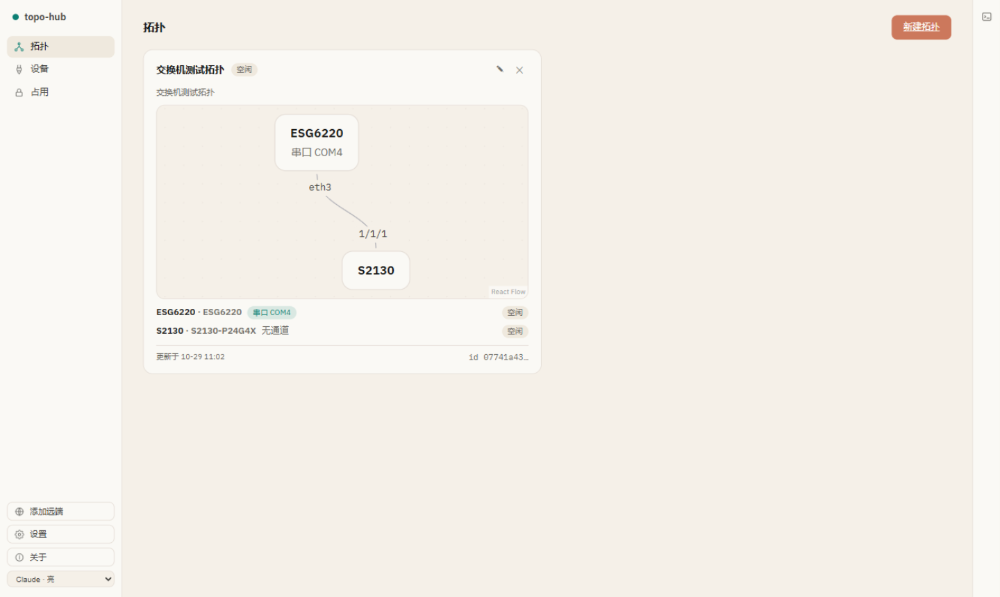

# devicerack

**English** · [简体中文](README.zh-CN.md)

A **network device management platform** for AI-driven device debugging: devices, topologies, exclusive leases, and an Agent tool surface — with serial/SSH/remote-cascade connectivity provided by the same Rust core.

devicerack and Serial Studio share one core but take different views: Serial Studio stands on the connection side (a serial terminal tool); devicerack stands on the device side (connections are just access channels to a device).

<p></p>

## ✨ Features

- **Device registry** — devices under test are first-class entities (name/model/location); serial consoles and SSH logins are inline access channels of the device. Unregistered ports remain directly reachable (field fallback).
- **Topology management** — multi-topology canvas editing (drag layout, device links, physical port labels like `GE0/1`); members reference devices and one device may belong to several topologies.
- **Occupancy leases** — device-level exclusive write access (all-or-nothing): conflicts are rejected as a whole with holder info, leases expire by TTL, queuing is supported; a web occupancy center lets humans inspect and force-release. A lease *is* write permission — commands can be issued as soon as it is held.
- **Device-ontology MCP tool surface (11 tools)** — discovery (`get_topology` / `get_device` / `list_my_leases`), leases (`acquire_lease` / `renew_lease` / `release_lease`), I/O (`exec_command` / `open_session` / `send_input` / `read_output` / `close_session`). Addressing is device+channel; agents never see port keys. Management tools (device/topology CRUD) are declared hidden from the tool list (still callable).
- **Terminal panel** — open a session from a device channel in one click; sessions survive page navigation, with a password-retry loop for auth failures.
- **Cascade & access control** — remote instance cascading; per-connection remote access verification (one-time codes + TLS).

## 🧱 Architecture

| Crate | Responsibility |
|---|---|
| `ss-core` | Serial engine: port lifecycle, event bus, scripting (QuickJS) |
| `ss-device` | Device access domain: SSH session pool, remote device clients, address resolution, port views, SFTP |
| `ss-server` | Data plane & composition root: WS/REST/MCP base, access control, macro/script libraries |
| `devicerack` | Topology domain: device registry, topologies, leases, audit, device-ontology tools, platform binary |
| `ui-rack` | Console SPA (React + React Flow) |

Dependency chain `devicerack → ss-server → ss-device → ss-core`: the platform reuses the tool's entire data plane (`/ws`, `/api/ports`, `/mcp`) and layers the device/topology/lease domain on top.

## 🛠 Tech stack

Rust + axum + tokio · React 18 + Vite + React Flow · rust-embed (SPA served from a single binary)

## 🚀 Getting started

```bash
# build frontend + release binary
npm --prefix ui-rack install && npm --prefix ui-rack run build
cargo build --release -p devicerack

# run (default 0.0.0.0:18800, distinct from serial-studio's 18700; isolated config dir)
./target/release/devicerack
```

## 📖 Usage

1. Register devices under test on the **Devices** page: add channels (local/cascade serial keys, or SSH host + auth);
2. Create topologies on the **Topologies** page; add members and links on the canvas (optionally labeled with physical ports);
3. Open `http://<host>:18800` in a browser, or let an agent connect via MCP.

## 🤖 MCP

`POST /mcp`, JSON-RPC (Streamable HTTP; `initialize` echoes back an `Mcp-Session-Id` header). Typical debugging chain:

```
get_topology          (pick a topology, inspect members)
  → acquire_lease     (device-level exclusive write access)
  → exec_command / open_session + send_input
                       (issue commands, keep CLI state)
  → release_lease     (return when done; I/O connections are retracted)
```

Session output is cursor-addressable (`read_output` for catch-up / watching debug output); lease release, expiry, and manual retraction all close that agent's connections, and every action lands in the audit log.

## ⚙️ Configuration

The config dir is isolated from serial-studio (`%APPDATA%/devicerack` / `~/.config/devicerack`): `devices.json` (devices & channels), `topologies.json`, `lease.json` (lease parameters), `settings.json`.

## 🔒 Security note

Same premise as serial-studio: trusted intranet, no auth by default. When exposing to a less-trusted network, enable remote access verification (rotating one-time codes + TLS; protected connections are blocked from Telnet and MCP).

## 📁 Project layout

```
crates/core        ss-core serial engine
crates/device      ss-device device access domain
crates/server      ss-server data plane & composition root
crates/devicerack    topology domain + platform binary (port 18800)
ui-rack/           console SPA
docs/              design docs (topo-hub-design.md / mcp-tools-design.md, etc.)
```

## 📄 License

[MIT](../../LICENSE)
